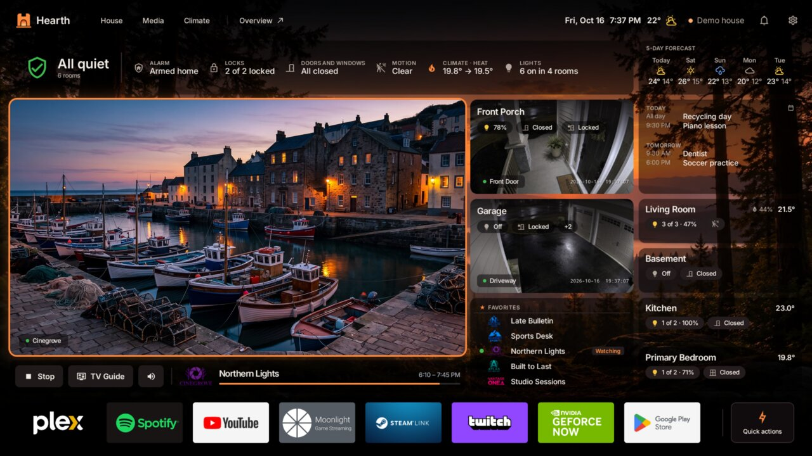

# Hearth

**Your apps, your own live TV and your home, on one Android TV screen built for the remote.**

**[hearthlauncher.com](https://hearthlauncher.com)** · [Changelog](CHANGELOG.md) ·
[Privacy](https://doitup-ca.github.io/privacy/)

## What it is

- **Only what you use.** First run asks whether you have Home Assistant, live TV, both, or just
  apps, and builds the home screen around the answer.
- **Live TV from your own provider or playlist,** with a guide, favorites, groups and search.
  Hearth includes no channels or subscriptions.
- **Your house from Home Assistant:** rooms, lights, temperatures, cameras and the weather.
- **Look, don't touch.** Lights, climate, fans and switches work from the couch. Locks and alarms
  are shown, never operated.
- **Private.** No account, no analytics, and nothing sent to us.

Screenshots and the full tour are on [hearthlauncher.com](https://hearthlauncher.com).

## Help and feedback

- **Bugs:** the [issue tracker](../../issues/new/choose).
- **Questions and ideas:** [Discussions](../../discussions).
- **Security problems:** not in issues, please. See [SECURITY.md](SECURITY.md).

This tracker is public. Logs and Home Assistant details often carry local addresses, tokens, and
the names of your rooms and devices, so please remove them before you paste.
[CONTRIBUTING.md](CONTRIBUTING.md) explains how.

If you like Hearth, the best help is telling someone who'd like it and leaving a review on Google
Play.

## This repository

Hearth's code is closed source. This repository is its public home: the overview, the changelog
and the issue tracker. Issues are answered here and fixed in a private repository.

Not affiliated with, endorsed by, or sponsored by Home Assistant, Nabu Casa, NVIDIA or Google.
